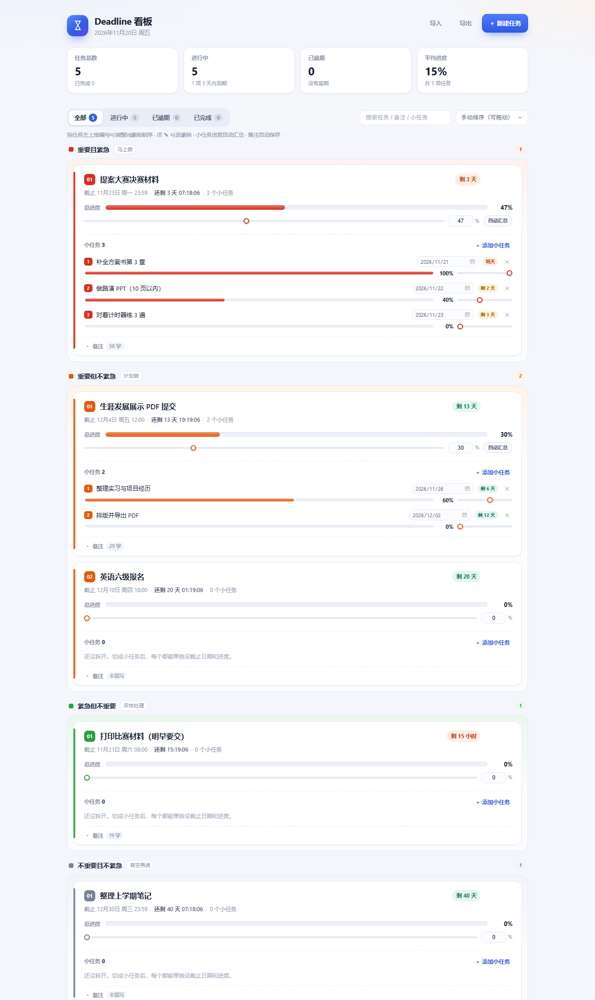

# Deadline 看板

一个**单文件、零依赖、纯本地**的 deadline 管理页面。双击 `deadline-board.html` 就能用，不需要服务器、不需要联网、不需要安装任何东西。

任务按**四象限**分区管理：重要且紧急（红）、重要但不紧急（橙）、紧急但不重要（绿）、不重要且不紧急（灰）。

## 为什么是单文件

- **打开即用**：拷到 U 盘、发给自己、放到桌面，双击就行
- **离线可用**：所有逻辑内联，没有 CDN、没有字体请求
- **数据自主**：任务只存在你自己浏览器的 localStorage 里，不上传任何服务器
- **易改**：一个 HTML 文件，改完刷新即可

## 功能

- **四象限**：新建任务时选择「重要 / 紧急」组合，自动归入对应象限；点 ✎ 可随时改象限
- **任务**：手动新建 / 编辑 deadline，卡片显示截止时间、实时倒计时、剩余天数角标（逾期标红）
- **进度**：每个任务一条独立进度条，拖滑块或直接输入百分比
- **小任务**：任意任务可拆成若干子任务，每个子任务有自己的进度条和截止日期
- **自动汇总**：子任务进度等权平均为总进度；可一键切换为手动设置
- **排序**：手动模式下拖动任务左上角编号，可调整**同一象限内**的显示顺序；切到按时间/进度排序时自动禁用拖动
- **备注**：每个任务底部有可折叠的纯文本备注区，输入即自动保存
- **管理**：全部 / 进行中 / 逾期 / 已完成筛选，关键词搜索
- **备份**：JSON 导出 / 导入，换电脑或换浏览器可迁移

## 使用

1. 双击 `deadline-board.html`（用 Edge / Chrome 等浏览器打开）
2. 首次打开点「新建第一个任务」，或「载入示例看看效果」
3. 选象限、拆小任务、拖进度、写备注，都会自动保存
4. 同象限内拖动任务左上角的编号可调整顺序
5. 重要节点点右上角「导出」存一份 JSON 备份

> 数据存在**当前浏览器**的 localStorage 中。清缓存、换浏览器、换电脑都会丢，请定期导出备份。
>
> 拖动排序依赖桌面浏览器的拖放能力，手机上可以用编辑弹窗改象限，但暂不支持拖动排序。

## 技术栈

- HTML5 + CSS3 + 原生 JavaScript（ES5 写法，无框架、无构建）
- 数据：`localStorage` + JSON，旧数据自动迁移（缺省按 3 天内到期判定为紧急）
- 渲染：模板字符串 + `innerHTML`，事件委托，原生 HTML5 拖放
- 响应式：桌面 / 移动端自适应

## 结构

| 部分 | 说明 |
| --- | --- |
| 样式 | 顶部 `:root` 变量控制主题色与四象限配色，`.quad` / `.card` / `.pbar` 控区块、卡片与进度条 |
| 数据 | `normalize()` 校验并补默认值，`load()` / `saveNow()` 读写 localStorage |
| 象限 | `quadOf()` 由 `important` / `urgent` 推导象限，`sectionHTML()` 分区渲染 |
| 计算 | `avgProgress()` 子任务平均，`eff()` 决定显示值，`badgeInfo()` 算 D-day |
| 排序 | `order` 字段 + `moveTask()`，仅在「手动排序」下允许拖动 |
| 交互 | document 级事件委托；拖进度只做局部 DOM 更新 |

## 路线图

- [ ] 子任务改名、任务置顶
- [ ] 导出 `.ics` 到手机日历
- [ ] 深色模式
- [ ] 附件链接 / Markdown 备注
- [ ] 手机端拖拽排序（Pointer Events）

## License

[MIT](LICENSE)
